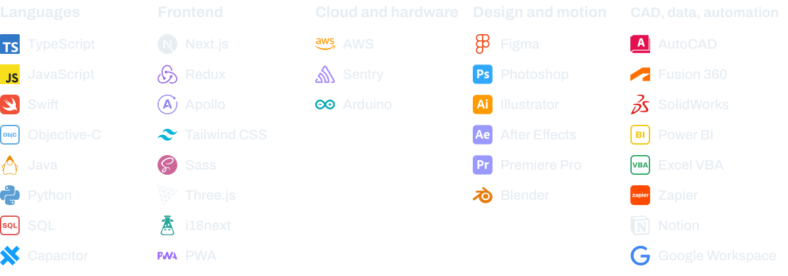
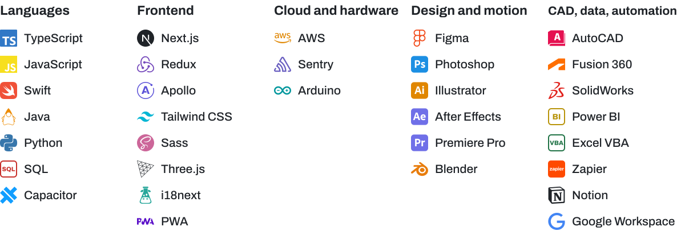
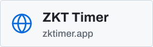

<a href="assets/map-dark.svg#gh-dark-mode-only"><picture><source media="(max-width: 640px)" srcset="assets/map-m-dark.svg" /></picture></a><a href="assets/map-light.svg#gh-light-mode-only"><picture><source media="(max-width: 640px)" srcset="assets/map-m-light.svg" /></picture></a>

<a href="assets/work-dark.svg#gh-dark-mode-only"><picture><source media="(max-width: 640px)" srcset="assets/work-m-dark.svg" /></picture></a><a href="assets/work-light.svg#gh-light-mode-only"><picture><source media="(max-width: 640px)" srcset="assets/work-m-light.svg" /></picture></a>

<a href="assets/stack-dark.svg#gh-dark-mode-only"><picture><source media="(max-width: 640px)" srcset="assets/stack-m-dark.svg" /></picture></a><a href="assets/stack-light.svg#gh-light-mode-only"><picture><source media="(max-width: 640px)" srcset="assets/stack-m-light.svg" /></picture></a>

<a href="https://zktimer.app"><picture><source media="(prefers-color-scheme: dark)" srcset="assets/link-web-dark.svg" /></picture></a>
<a href="https://zekakuputurkiye.com"><picture><source media="(prefers-color-scheme: dark)" srcset="assets/link-site-dark.svg" /></picture></a>
<a href="mailto:ibrhyyme@icloud.com"><picture><source media="(prefers-color-scheme: dark)" srcset="assets/link-mail-dark.svg" /></picture></a>
<a href="https://www.instagram.com/zkttimer/"><picture><source media="(prefers-color-scheme: dark)" srcset="assets/link-ig-dark.svg" /></picture></a>

